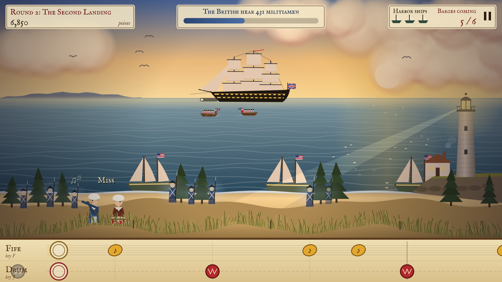

# The Army of Two

A fife-and-drum rhythm game set in Scituate in 1814. You play Rebecca and Abigail Bates, the lighthouse keeper's daughters. Barges of redcoats row in from HMS *La Hogue* to burn the harbor's ships. Play *Yankee Doodle* in time and the British come to believe a whole militia is hiding in the cedars.

**How it plays**
- Gold notes go on the **fife** (`F`, or tap the top music row). Red notes go on the **drum** (`J`, or tap the bottom row).
- Run between the three dunes with `←` `→` (or `1` `2` `3`, or tap a dune). Your music scares the barge straight ahead the most.
- Each good note grows the "phantom militia" meter, and ghostly militiamen appear along the dunes. The fuller the meter, the faster the barges lose their nerve.
- If a barge reaches the beach, it burns one of the three harbor ships. Lose all three and the game ends.
- There are three rounds: afternoon, golden hour, then sunset with the lighthouse lit. Each round has a faster tempo and more barges.

All the art is drawn in code and all the music is played live in the browser, so there are no image or audio files. Your best score is saved on the device.

## Install on iPhone or iPad
1. Open `https://bogar45.github.io/winter-training-camp/armyoftwo/` in **Safari**.
2. Tap **Share → Add to Home Screen**. Play with the device held sideways.

